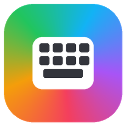
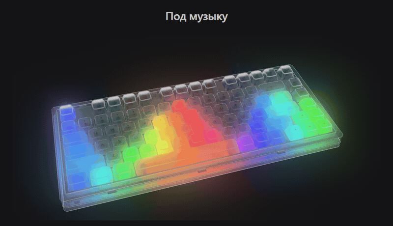
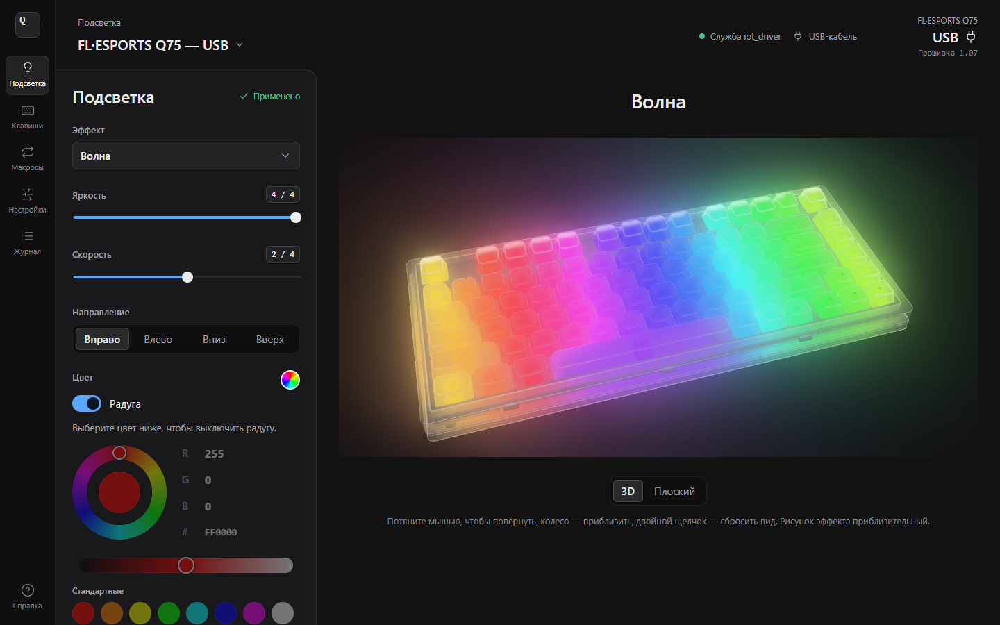
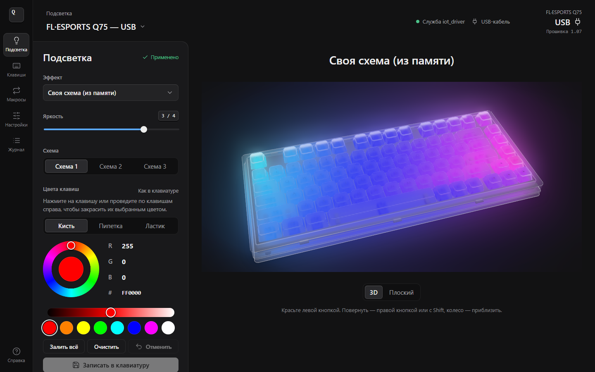
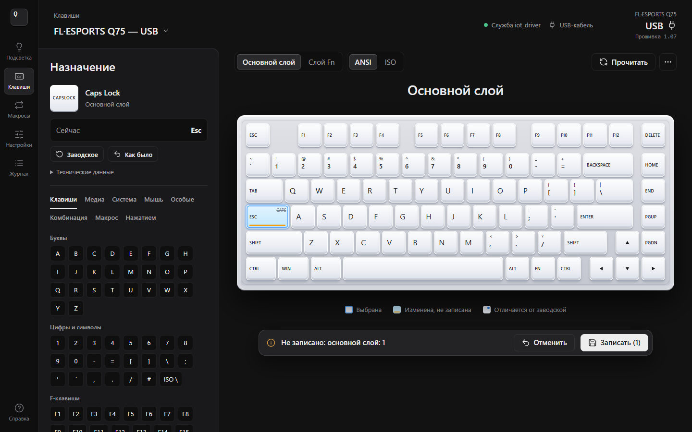
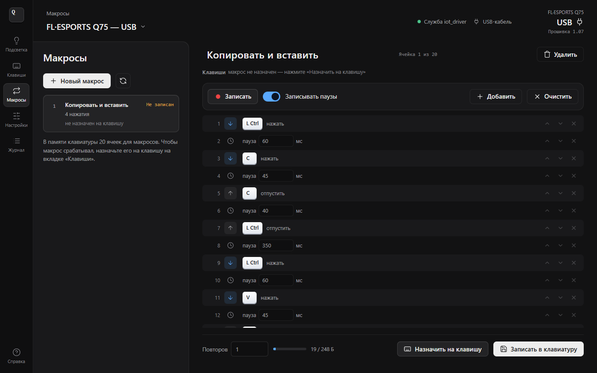
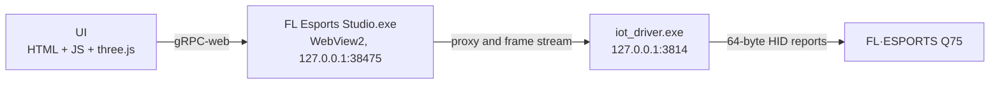

<p align="center">
  
</p>

<h1 align="center">FL Esports Studio</h1>

<p align="center">
  Open-source configuration app for the <b>FL·ESPORTS Q75</b> keyboard, a replacement for the stock “F. L Driver”.<br>
  Lighting, per-key custom scheme, music-reactive lighting, key remapping and macros —<br>
  no ads, no accounts, no internet.
</p>

<p align="center">
  <a href="https://github.com/Kw3nty/fl-esports-studio/releases/latest"></a>
</p>

<p align="center">
  <a href="https://github.com/Kw3nty/fl-esports-studio/actions/workflows/build.yml"></a>
  
  <a href="LICENSE"></a>
  
  
  
  <a href="#support-the-project"></a>
</p>

<p align="center">
  <a href="README.md">Русский</a> · <b>English</b> · <a href="CHANGELOG.md">Changelog</a> · <a href="docs/PROTOCOL.md">Q75 protocol</a>
</p>

<p align="center">
  
</p>

> [!NOTE]
> This is an unofficial project and is not affiliated with the keyboard manufacturer. The keyboard firmware is never overwritten: only user settings are changed, and “Factory reset” always restores the original state.
>
> The user interface is currently in **Russian**.

## Features

- **Lighting**: 18 built-in firmware effects (static, breathing, neon, wave, ripple, snake, laser, meteor, rain and more), brightness and speed 0–4, direction, custom color or rainbow, live 3D preview with a transparent case and crystal keycaps.
- **Custom scheme**: per-key colors with brush, eyedropper, eraser and fill. The scheme is stored in the keyboard and works without the app.
- **Music & screen color**: 32 spectrum bars driven by the audio playing on the PC (WASAPI loopback), or lighting that follows the average screen color. Keeps working when the window is closed.
- **Keys**: remap any key on the base and Fn layers to regular or media keys, system functions, mouse buttons, shortcuts or macros, or disable it. Knob support, ANSI and ISO layouts, JSON backups.
- **Macros**: 20 slots in keyboard memory, recording with real or fixed delays, step editor, three playback modes (“N times”, “While held”, “Toggle”). Byte-for-byte compatible with the stock driver.
- **Settings**: polling rate 125–1000 Hz, debounce 0–10 ms, Win lock, WASD ↔ arrows swap, sleep timers, factory reset, a raw HID log and a demo mode.

<table>
  <tr>
    <td width="50%"></td>
    <td width="50%"></td>
  </tr>
  <tr>
    <td width="50%"></td>
    <td width="50%"></td>
  </tr>
</table>

## Supported keyboards

| Model | Revision | USB cable | 2.4G dongle |
|---|---|:---:|:---:|
| FL·ESPORTS Q75 | `yc200_k232` | ✅ | ✅ |
| FL·ESPORTS Q75 with knob | `yc300_k239` | ✅ | ✅ |
| SOC revision | `yc500_k239_soc` | — | — |

`yc500_k239_soc` is detected but not supported yet because it uses a different command set.

## Installation

1. Download `FL-Esports-Studio-<version>-windows-x64.zip` from [Releases](https://github.com/Kw3nty/fl-esports-studio/releases/latest) and unpack it anywhere.
2. The app needs the `iot_driver.exe` service from the stock “F. L Driver” (see [How it works](#how-it-works)). If the stock driver is installed, it is found automatically; otherwise copy `iot_driver.exe` next to `FL Esports Studio.exe`.
3. Run **`FL Esports Studio.exe`** and connect the keyboard by cable or via the 2.4G dongle.

> [!IMPORTANT]
> Do not run FL Esports Studio and the stock F. L Driver at the same time: both would send commands to the same keyboard.

The exe is not code-signed, so Windows SmartScreen may warn on first launch: click “More info”, then “Run anyway”. SHA-256 checksums are published with every release, and you can always [build it yourself](#building-from-source).

Requirements: Windows 10 or 11 (x64). The window uses WebView2, which ships with Windows 10 and 11; without it the UI opens in Microsoft Edge or the default browser.

### Background mode

When “Music” or “Screen color” is active, closing the window keeps the lighting running: the app stays in the notification area (about 15–20 MB of RAM, no window and no WebView2). Left-click the icon to reopen the window; right-click for “Open”, “Start with Windows” and “Exit”. With autostart enabled, music lighting starts right after you sign in. With a regular effect selected, closing the window simply exits the app.

## How it works



Windows does not let web pages talk to keyboards directly (WebHID blocks keyboard-class devices), so the app uses the stock `iot_driver.exe` service purely as a USB bridge: it accepts gRPC-web calls on `127.0.0.1:3814` and forwards 64-byte HID reports. Everything else (commands, formats, layouts, effects and the UI) is written from scratch and lives in this repository. The protocol is documented in [docs/PROTOCOL.md](docs/PROTOCOL.md) (in Russian).

> [!NOTE]
> `iot_driver.exe` is proprietary vendor software. It is **not** included in this repository or in the releases.

## Safety

- The layout is always read from the keyboard before writing; only the changed keys are modified.
- Writes are blocked if the keyboard response does not look like a valid layout.
- After writing, the data is read back and compared byte by byte.
- Unknown settings bits are preserved.
- Firmware and bootloader update commands are **intentionally not implemented**.
- The app never connects to the internet and listens on `127.0.0.1` only.

## Building from source

Requires Python 3.10+ and Go 1.24+. Node.js 18+ is only needed for tests and screenshots.

```powershell
.\build.ps1                                       # HTML -> exe -> zip in release\

python build.py                                   # or step by step: dist\FLEsportsStudio.html
Copy-Item dist\FLEsportsStudio.html launcher\ui\
cd launcher
$env:GOOS = 'windows'; $env:GOARCH = 'amd64'; $env:CGO_ENABLED = '0'
go build -trimpath -ldflags "-H windowsgui -s -w" -o "..\dist\FL Esports Studio.exe" .
```

Tests: `node test/unit.js`, `node test/userpic.js`, `go test ./...` in `launcher/`, and `node test/e2e.js` (needs Playwright). Screenshots and the GIF are generated with `node tools/screenshots.js`. See [CONTRIBUTING.md](CONTRIBUTING.md) for details.

## Support the project

FL Esports Studio is free, open source and ad-free. If it is useful to you, you can buy the author a coffee ☕

**USDT TRC-20 (Tron)**

```text
TVGbahTRp8QjrU4pHxrop7VNdQ5xhoTngZ
```

**USDT ERC-20 (Ethereum)**

```text
0x3A0a4287A488C6C8BCFBc8e8acD1409b8ffE48E0
```

> [!IMPORTANT]
> Send only USDT and only on the network listed for that address, otherwise the transfer will be lost. QR codes for mobile wallets are in the [Donate section on fbads.fun](https://fbads.fun/#donate).

Thank you! 🙏

## License

[MIT](LICENSE). Third-party components are listed in [THIRD_PARTY_NOTICES.md](THIRD_PARTY_NOTICES.md).

FL·ESPORTS and other names are trademarks of their respective owners. This project is not affiliated with the keyboard manufacturer and is provided “as is”, without warranty.
