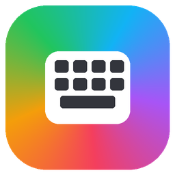
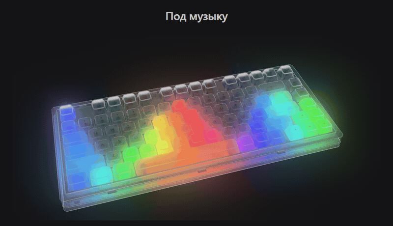
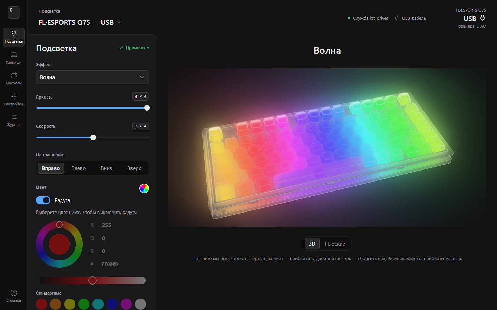
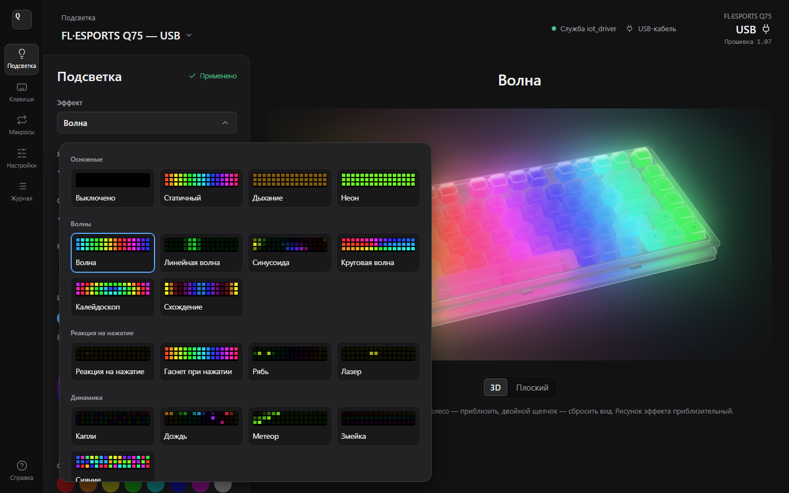
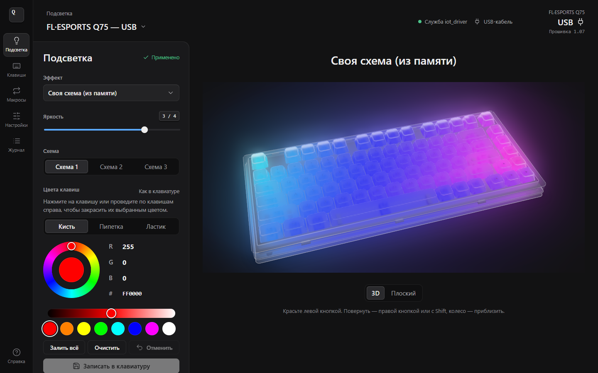
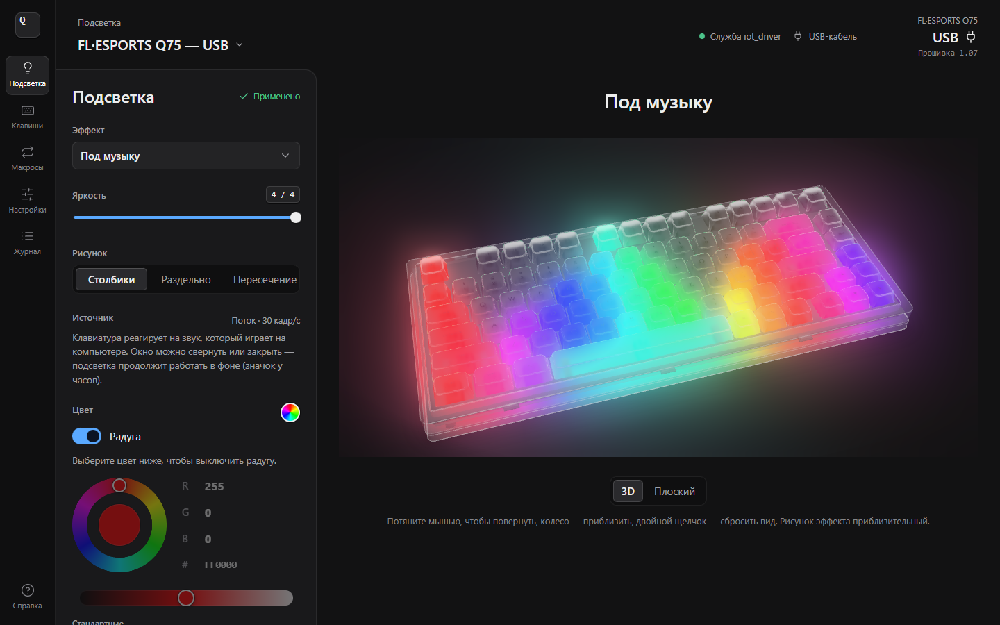
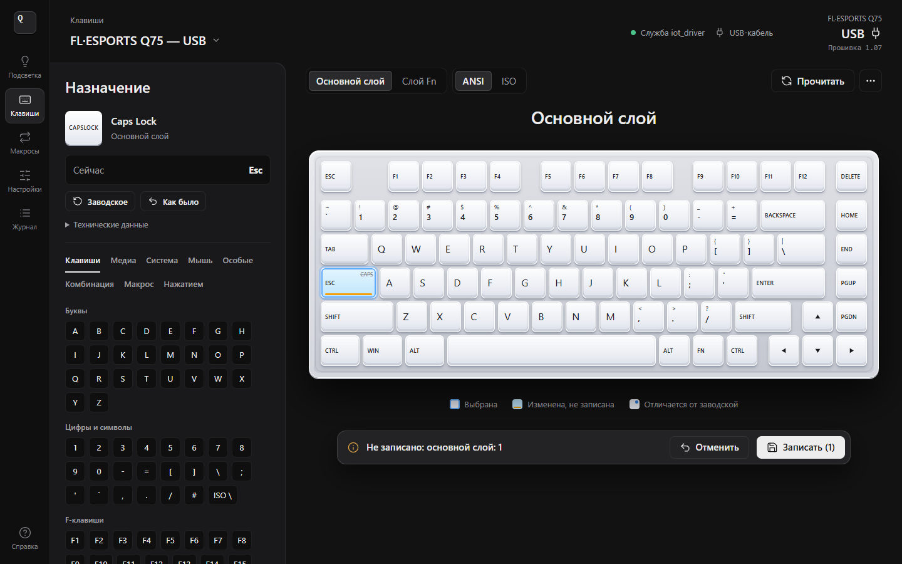
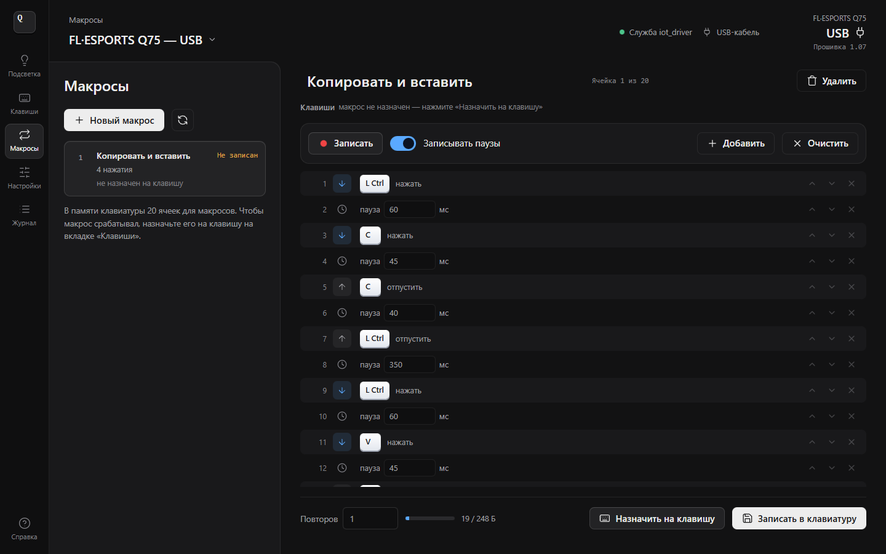
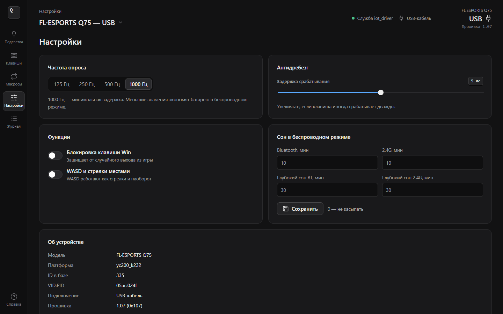
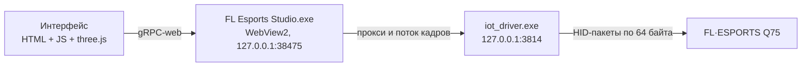

<p align="center">
  
</p>

<h1 align="center">FL Esports Studio</h1>

<p align="center">
  Открытая программа настройки клавиатуры <b>FL·ESPORTS Q75</b> вместо оригинального «F. L Driver».<br>
  Подсветка, своя схема по клавишам, подсветка под музыку, переназначение клавиш и макросы —<br>
  без рекламы, аккаунтов и интернета.
</p>

<p align="center">
  <a href="https://github.com/Kw3nty/fl-esports-studio/releases/latest"></a>
</p>

<p align="center">
  <a href="https://github.com/Kw3nty/fl-esports-studio/actions/workflows/build.yml"></a>
  
  <a href="LICENSE"></a>
  
  
  
</p>

<p align="center">
  <b>Русский</b> · <a href="README.en.md">English</a> · <a href="CHANGELOG.md">Что нового</a> · <a href="docs/PROTOCOL.md">Протокол Q75</a>
</p>

<p align="center">
  
</p>

> [!NOTE]
> Это неофициальный проект, он не связан с производителем клавиатуры. Прошивка клавиатуры не перезаписывается: меняются только пользовательские настройки, а «Сброс к заводским» всегда возвращает исходное состояние.

## Содержание

- [Возможности](#возможности)
- [Поддерживаемые клавиатуры](#поддерживаемые-клавиатуры)
- [Установка](#установка)
- [Работа в фоне](#работа-в-фоне)
- [Как это устроено](#как-это-устроено)
- [Безопасность](#безопасность)
- [Сборка из исходников](#сборка-из-исходников)
- [Вопросы и ответы](#вопросы-и-ответы)
- [Лицензия](#лицензия)

## Возможности

### 💡 Подсветка

- 18 встроенных эффектов прошивки: статичный, дыхание, неон, волна, рябь, капли, змейка, лазер, метеор, дождь, сияние и другие;
- яркость и скорость 0–4, направление, свой цвет или радуга;
- живой 3D-предпросмотр: прозрачный корпус, кристальные кейкапы, свечение сквозь клавиши и вокруг корпуса;
- палитра в стиле G HUB: кольцо оттенка, HEX и R / G / B, полоса светлоты, свои сохранённые цвета.

<table>
  <tr>
    <td width="50%"></td>
    <td width="50%"></td>
  </tr>
</table>

### 🎨 Своя схема

Цвет каждой клавиши отдельно: кисть, пипетка, ластик, «Залить всё», отмена. Схема записывается в память клавиатуры и дальше работает без программы, даже на другом компьютере.

<p align="center"></p>

### 🎵 Под музыку и цвет экрана

- **Под музыку**: клавиатура рисует 32 столбика по звуку, который играет на ПК. Рисунки «Столбики», «Раздельно», «Пересечение», свой цвет или радуга.
- **Цвет экрана**: подсветка повторяет средний цвет экрана, это удобно в играх и фильмах.
- Звук (WASAPI loopback) и экран захватывает сам `FL Esports Studio.exe`, поэтому подсветка работает со свёрнутым и даже с закрытым окном (см. [Работа в фоне](#работа-в-фоне)).

<p align="center"></p>

### ⌨️ Клавиши

- переназначение любой клавиши основного слоя и слоя Fn;
- обычные и медиа-клавиши, системные функции, кнопки мыши, комбинации (Ctrl+C и т. п.), макросы, отключение клавиши;
- захват нажатия с реальной клавиатуры, настройка крутилки (нажатие и повороты), раскладки ANSI и ISO;
- изменения копятся в панели «Не записано: N» и записываются одной кнопкой, оба слоя сразу;
- резервная копия раскладки и макросов в файл `.json`.

<p align="center"></p>

### 🔁 Макросы

- 20 ячеек в памяти клавиатуры, свои названия;
- запись нажатий с реальными или фиксированными паузами;
- редактор шагов: паузы, порядок, клавиши, кнопки мыши, число повторов, индикатор занятой памяти;
- назначение на клавишу в трёх режимах: «N раз», «Пока нажата», «Вкл / выкл»;
- формат совпадает с оригинальным драйвером байт в байт (проверено на 300 случайных макросах).

<p align="center"></p>

### ⚙️ Настройки и диагностика

Частота опроса 125–1000 Гц, антидребезг 0–10 мс, блокировка Win, обмен WASD ↔ стрелки, таймеры сна для 2.4G и Bluetooth, сброс к заводским. Вкладка «Журнал» показывает все пакеты обмена с клавиатурой в hex. Демо-режим позволяет посмотреть интерфейс без клавиатуры.

<p align="center"></p>

## Поддерживаемые клавиатуры

| Модель | Ревизия | USB-кабель | 2.4G-приёмник |
|---|---|:---:|:---:|
| FL·ESPORTS Q75 | `yc200_k232` | ✅ | ✅ |
| FL·ESPORTS Q75 с крутилкой | `yc300_k239` | ✅ | ✅ |
| SOC-ревизия | `yc500_k239_soc` | — | — |

Ревизию видно на вкладке «Настройки». `yc500_k239_soc` определяется, но пока не поддерживается: у неё другой набор команд.

## Установка

1. Скачайте `FL-Esports-Studio-<версия>-windows-x64.zip` со страницы [Releases](https://github.com/Kw3nty/fl-esports-studio/releases/latest) и распакуйте в любую папку.
2. Нужна служба `iot_driver.exe` из оригинального «F. L Driver» (почему, см. [Как это устроено](#как-это-устроено)). Если оригинальный драйвер установлен, программа найдёт её сама: рядом с exe, в `F. L Driver\resources\app`, в `Program Files` и в `%APPDATA%\F. L Driver`. Иначе скопируйте `iot_driver.exe` рядом с `FL Esports Studio.exe`.
3. Запустите **`FL Esports Studio.exe`** и подключите клавиатуру кабелем или через 2.4G-приёмник. Она определится автоматически.

> [!IMPORTANT]
> Не держите одновременно открытыми FL Esports Studio и оригинальный F. L Driver: обе программы будут слать команды одной клавиатуре.

**SmartScreen.** Exe не подписан сертификатом, поэтому при первом запуске Windows может показать «Система Windows защитила ваш компьютер». Нажмите «Подробнее», затем «Выполнить в любом случае». Контрольные суммы лежат в `SHA256SUMS.txt` на странице релиза, а exe можно [собрать самому](#сборка-из-исходников).

**Требования:** Windows 10 или 11 (x64). Окно использует WebView2, он встроен в Windows 10 и 11. Если WebView2 нет, интерфейс откроется в Microsoft Edge или в браузере по умолчанию.

Что лежит в архиве:

```text
FL Esports Studio.exe             программа: окно, запуск службы, значок у часов
FLEsportsStudio.html              тот же интерфейс одним файлом, для запуска через браузер
Запустить FL Esports Studio.bat   запасной способ запуска без exe
Остановить службу.bat             выгрузить фоновую службу iot_driver
README.md, CHANGELOG.md, PROTOCOL.md, LICENSE, THIRD_PARTY_NOTICES.md
```

## Работа в фоне

Если на клавиатуре включены «Под музыку» или «Цвет экрана», после закрытия окна подсветка продолжает работать. Программа остаётся значком у часов (в Windows 11 он может прятаться под стрелкой «^») и занимает около 15–20 МБ памяти, без окна и WebView2.

- щелчок по значку снова открывает окно;
- правая кнопка открывает меню: «Открыть», «Запускать вместе с Windows», «Выход»;
- с автозапуском подсветка под музыку включается сама после входа в Windows, окно открывать не нужно;
- последний живой режим запоминается в `%LOCALAPPDATA%\Q75Studio\live.json`.

Если выбран обычный эффект, при закрытии окна программа просто завершается: обычные эффекты и своя схема хранятся в самой клавиатуре.

После переключения режима клавиатура примерно на 15 секунд пропадает (так делает её прошивка). Поток сам дождётся её и продолжит, статус видно в строке под режимом.

## Как это устроено



Windows не даёт веб-страницам прямой доступ к клавиатурам (WebHID блокирует устройства класса «клавиатура»). Поэтому для обмена по USB используется фоновая служба `iot_driver.exe` из оригинального комплекта: она принимает команды на `127.0.0.1:3814` (gRPC-web) и передаёт клавиатуре 64-байтные HID-пакеты. Всё остальное (команды, форматы, раскладки, эффекты, интерфейс) написано с нуля и лежит в этом репозитории. Протокол описан в [docs/PROTOCOL.md](docs/PROTOCOL.md).

`FL Esports Studio.exe` встраивает интерфейс, сам запускает службу без окна консоли и останавливает её при выходе, если запускал её сам. Кроме того, он захватывает звук и экран для живых режимов и показывает значок у часов.

> [!NOTE]
> `iot_driver.exe` — проприетарный файл производителя. Он **не входит** ни в репозиторий, ни в релизы.

## Безопасность

- Перед записью раскладка всегда читается с клавиатуры. Меняются только выбранные клавиши, остальное записывается как было.
- Если ответ клавиатуры не похож на раскладку, запись блокируется с предупреждением.
- После записи раскладка и макросы читаются повторно и сверяются побайтно.
- Неизвестные биты настроек сохраняются как есть.
- Команды обновления прошивки и загрузчика в программу **намеренно не включены**.
- Программа не обращается в интернет и слушает только `127.0.0.1`.

Нашли уязвимость? Прочитайте [SECURITY.md](SECURITY.md).

## Сборка из исходников

Понадобятся Python 3.10+ и Go 1.24+. Node.js 18+ нужен только для тестов и скриншотов.

```powershell
# всё сразу: HTML -> exe -> zip в папке release\
.\build.ps1

# или по шагам
python build.py                                   # dist\FLEsportsStudio.html из src\*
Copy-Item dist\FLEsportsStudio.html launcher\ui\
cd launcher
$env:GOOS = 'windows'; $env:GOARCH = 'amd64'; $env:CGO_ENABLED = '0'
go build -trimpath -ldflags "-H windowsgui -s -w" -o "..\dist\FL Esports Studio.exe" .
```

Go собирает exe для Windows на любой ОС, в Linux и macOS достаточно тех же переменных `GOOS`, `GOARCH` и `CGO_ENABLED`.

### Тесты

```powershell
node test/unit.js           # протокол: пакеты, контрольные суммы, форматы раскладки и макросов
node test/userpic.js        # своя схема (SET_USERPIC)
cd launcher; go test ./...  # Go: сервер и прокси
node test/e2e.js            # сквозной: HTML -> gRPC-web -> мок службы -> симулятор прошивки
```

Для `e2e.js` нужен Playwright: `npm i --no-save playwright`, затем `npx playwright install chromium`. Вместо скачивания браузера можно указать свой Chrome в переменной `CHROMIUM_PATH`.

### Скриншоты и GIF

`tools/screenshots.js` поднимает интерфейс с мок-службой и симулятором клавиатуры, снимает экраны в headless Chrome и собирает `music.gif` через ffmpeg:

```powershell
node tools/screenshots.js                          # все сцены в docs\screenshots
node tools/screenshots.js --only=lighting,music-gif
```

Переменные окружения: `CHROME` (путь к Chrome), `FFMPEG` (путь к ffmpeg), `CDP_PORT` (порт отладки, по умолчанию 9333), `EXT_CHROME=1` (подключиться к уже запущенному Chrome).

### Структура проекта

```text
src/        интерфейс: core.js (транспорт и протокол), keys.js (коды и раскладка),
            app.js (UI), kb3d.js (3D-клавиатура), effects.js, sim.js (симулятор), ...
launcher/   Go: окно WebView2, запуск iot_driver, прокси, захват звука и экрана, трей
test/       unit, userpic и e2e тесты, мок службы iot_driver
tools/      screenshots.js: скриншоты и GIF для README
docs/       PROTOCOL.md, скриншоты и медиа
scripts/    .bat для запуска без exe и остановки службы
build.py    сборка одного HTML-файла из src/
build.ps1   полная сборка релиза
```

## Вопросы и ответы

<details>
<summary><b>Работает ли подсветка без программы?</b></summary>

Обычные эффекты и своя схема хранятся в клавиатуре и работают без программы, даже на другом компьютере. «Под музыку» и «Цвет экрана» без программы невозможны: клавиатура не слышит звук компьютера, его захватывает и пересчитывает в столбики программа на ПК.
</details>

<details>
<summary><b>Можно ли открыть интерфейс в браузере?</b></summary>

Да: `Запустить FL Esports Studio.bat` запустит службу и откроет `FLEsportsStudio.html`. В этом режиме недоступны только «Под музыку» и «Цвет экрана», потому что их считает exe.
</details>

<details>
<summary><b>Антивирус или SmartScreen ругается на exe</b></summary>

Файл не подписан платным сертификатом, отсюда и предупреждение. Сверьте SHA-256 с `SHA256SUMS.txt` из релиза или соберите exe сами, это занимает меньше минуты.
</details>

<details>
<summary><b>После смены режима клавиатура пропала</b></summary>

Так ведёт себя прошивка: после переключения режима клавиатура переподключается примерно 15 секунд. Программа дождётся её сама.
</details>

<details>
<summary><b>Где хранятся настройки и как всё удалить?</b></summary>

Настройки интерфейса, живой режим и данные WebView2 лежат в `%LOCALAPPDATA%\Q75Studio`. Чтобы удалить программу, снимите «Запускать вместе с Windows» в меню значка, нажмите «Выход», затем удалите папку программы и `%LOCALAPPDATA%\Q75Studio`.
</details>

<details>
<summary><b>Моя ревизия не поддерживается</b></summary>

Откройте [issue](https://github.com/Kw3nty/fl-esports-studio/issues/new/choose) и приложите ревизию с вкладки «Настройки» и последние строки вкладки «Журнал».
</details>

## Участие в разработке

Баг-репорты, идеи и pull request'ы приветствуются, подробности в [CONTRIBUTING.md](CONTRIBUTING.md).

## Лицензия

[MIT](LICENSE). Сторонние компоненты (three.js, go-webview2, go-winloader, golang.org/x/sys) перечислены в [THIRD_PARTY_NOTICES.md](THIRD_PARTY_NOTICES.md).

FL·ESPORTS и другие названия принадлежат их владельцам. Проект не связан с производителем клавиатуры и распространяется «как есть», без гарантий.
